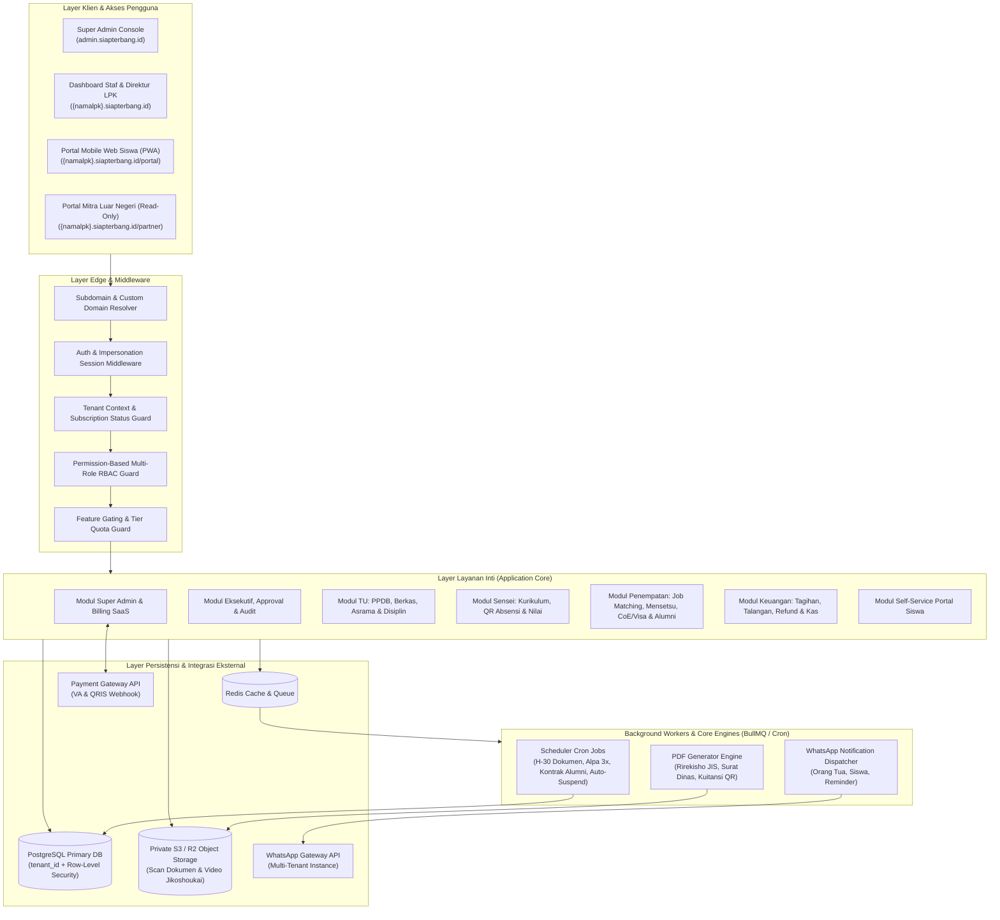
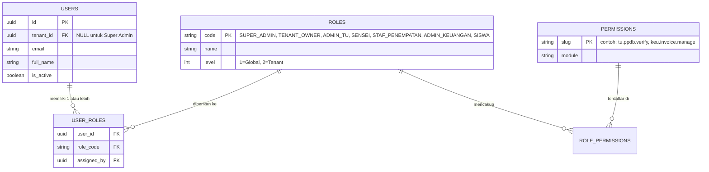

# System Architecture & Engineering Blueprint — SiapTerbang SaaS

| Metadata Arsitektur | Spesifikasi Teknis |
| :--- | :--- |
| **Nama Sistem** | **SiapTerbang** (`siapterbang.id`) |
| **Pola Arsitektur** | Modular Multi-Tenant SaaS (Single Database, Isolated Tenant Workspace via `tenant_id` & Subdomain) |
| **Model Otorisasi** | Permission-Based RBAC (7 Role Terintegrasi + Dukungan Multi-Role per Akun + Owner Override & Approval) |
| **Cakupan Implementasi** | 100% End-to-End Mapping terhadap seluruh fitur, sub-fitur, dan logika bisnis pada `SiapTerbang.pdf` & `PRD.md` |

---

## Daftar Isi

1. [High-Level System Architecture & Tech Stack](#1-high-level-system-architecture--tech-stack)
2. [Arsitektur Multi-Tenancy & Isolasi Workspace](#2-arsitektur-multi-tenancy--isolasi-workspace)
3. [Permission-Based RBAC & Multi-Role Architecture (7 Roles)](#3-permission-based-rbac--multi-role-architecture-7-roles)
4. [Skema Database Komplit (ERD & Spesifikasi Tabel 100% Fitur)](#4-skema-database-komplit-erd--spesifikasi-tabel-100-fitur)
5. [Implementasi Teknis Cross-Role Locks & State Machine](#5-implementasi-teknis-cross-role-locks--state-machine)
6. [Spesifikasi Mesin Inti (Core Technical Engines)](#6-spesifikasi-mesin-inti-core-technical-engines)
   - [6.1 Mesin Auto-Generator Rirekisho (CV Jepang) & Surat Resmi PDF](#61-mesin-auto-generator-rirekisho-cv-jepang--surat-resmi-pdf)
   - [6.2 Mesin WhatsApp Gateway & Notifikasi Otomatis Orang Tua](#62-mesin-whatsapp-gateway--notifikasi-otomatis-orang-tua)
   - [6.3 Mesin Kalkulator Refund & Anti-Fraud Approval Center](#63-mesin-kalkulator-refund--anti-fraud-approval-center)
   - [6.4 Mesin Pelacak Kedaluwarsa Dokumen (H-30 Expiry Tracker) & Presensi Alpa](#64-mesin-pelacak-kedaluwarsa-dokumen-h-30-expiry-tracker--presensi-alpa)
   - [6.5 Mesin SaaS Feature Gating, Kuota & Billing Otomatis](#65-mesin-saas-feature-gating-kuota--billing-otomatis)
7. [Pemetaan 100% Fitur Role ke Modul Aplikasi & Endpoint API](#7-pemetaan-100-fitur-role-ke-modul-aplikasi--endpoint-api)
8. [Struktur Direktori Proyek (Full-Stack Modular Architecture)](#8-struktur-direktori-proyek-full-stack-modular-architecture)

---

## 1. High-Level System Architecture & Tech Stack



### Spesifikasi Tech Stack Produksi

| Komponen | Teknologi Utama | Justifikasi Teknis |
| :--- | :--- | :--- |
| **Frontend & Full-Stack Framework** | **Next.js (App Router) + TypeScript** | Mendukung *Multi-Tenant Subdomain Routing* via `middleware.ts`, SSR/Server Actions, serta antarmuka PWA responsif untuk Portal Mobile Web Siswa. |
| **UI Component & Styling** | **Tailwind CSS + shadcn/ui + Recharts** | Konsistensi komponen enterprise, aksesibilitas tinggi, dan dukungan grafik analitik eksekutif. |
| **Database Utama** | **PostgreSQL 16+** | Mendukung *Row-Level Security (RLS)* untuk isolasi `tenant_id` yang ketat, transaksi ACID untuk keuangan, serta tipe data `JSONB` untuk struktur dinamis. |
| **ORM & Database Client** | **Prisma ORM / Drizzle ORM** | Type-safety penuh dan dukungan *Client Extensions* untuk menyuntikkan filter `tenant_id` secara otomatis di setiap kueri. |
| **Authentication & Session** | **Auth.js (NextAuth) / Lucia + JWT** | Mendukung sesi multi-role, *Subdomain Cookie Scoping*, dan fitur *Impersonate (Login As Tenant Owner)* oleh Super Admin. |
| **Document & Media Storage** | **Cloudflare R2 / AWS S3 (Private Bucket)** | Menyimpan scan dokumen sensitif (KTP, KK, Paspor, MCU) dan video *Jikoshoukai* secara terenkripsi dengan akses berbasis *Presigned URL* berbatas waktu. |
| **PDF & Document Engine** | **Puppeteer / `@react-pdf/renderer` + `qrcode`** | Menghasilkan CV Jepang (*Rirekisho*) berstandar grid JIS, surat resmi berkop LPK, dan kuitansi digital ber-QR Code dengan presisi cetak 100%. |
| **Queue & Background Jobs** | **BullMQ + Redis / Cron Scheduler** | Menangani pengiriman WhatsApp massal, generasi PDF berat, pengecekan dokumen kedaluwarsa $H-30$, dan auto-suspend tenant menunggak. |

---

## 2. Arsitektur Multi-Tenancy & Isolasi Workspace

### 2.1 Resolusi Subdomain & Ruang Kerja (`Workspace Isolation`)
Setiap request HTTP dievaluasi pada *Edge Middleware* untuk menentukan konteks ruang kerja:

1. **`admin.siapterbang.id`**:
   * Konteks: **Ruang Global (`tenant_id = NULL`)**.
   * Hanya mengizinkan akun dengan role `SUPER_ADMIN`.
2. **`{subdomain}.siapterbang.id`** (contoh: `lpkmaju.siapterbang.id`) atau **Custom Domain** (`sistem.lpkmaju.co.id` untuk paket *Enterprise*):
   * Middleware melakukan *lookup* ke tabel `tenants` (dengan caching Redis) untuk mendapatkan `tenant_id`, `status`, dan `plan_tier`.
   * Seluruh operasi baca/tulis pada request tersebut dikunci secara mutlak pada `tenant_id` hasil resolusi.

### 2.2 Siklus Status Langganan Tenant & Auto-Suspend
* **`TRIAL` / `ACTIVE`**: Seluruh staf dan siswa dapat mengakses sistem sesuai paket langganan.
* **`GRACE_PERIOD`** (Tagihan jatuh tempo, dalam masa tenggang $H+1$ s/d $H+7$): Menampilkan banner peringatan merah di atas layar Tenant Owner.
* **`SUSPENDED`** (Melewati masa tenggang):
  * Sistem **otomatis membekukan akses login** seluruh role operasional (`ADMIN_TU`, `SENSEI`, `STAF_PENEMPATAN`, `ADMIN_KEUANGAN`, `SISWA`).
  * Hanya `TENANT_OWNER` yang diizinkan login, dan seluruh navigasinya diarahkan paksa (*forced redirect*) ke halaman `/owner/billing` hingga invoice langganan dilunasi via Virtual Account / QRIS.

### 2.3 Pertahanan Berlapis Isolasi Data (Defense-in-Depth)
1. **Application Layer (ORM Tenant Extension)**: Setiap kueri `SELECT`, `UPDATE`, dan `DELETE` pada tabel tenant wajib menyertakan klausa `WHERE tenant_id = current_tenant_id`.
2. **Database Layer (PostgreSQL Row-Level Security - RLS)**:
   ```sql
   ALTER TABLE students ENABLE ROW LEVEL SECURITY;
   CREATE POLICY tenant_isolation_policy ON students
     USING (tenant_id = current_setting('app.current_tenant_id', true)::uuid);
   ```

---

## 3. Permission-Based RBAC & Multi-Role Architecture (7 Roles)

### 3.1 Desain Multi-Role per Akun
Untuk mengakomodasi operasional LPK daerah di mana satu staf sering merangkap fungsi (contoh: Admin TU merangkap Admin Keuangan), hak akses **tidak** disimpan sebagai satu kolom string tunggal pada tabel `users`, melainkan menggunakan skema relasional **Many-to-Many Permission-Based RBAC**:



### 3.2 Cara Kerja Penggabungan Hak Akses (Union of Permissions)
Saat pengguna login, sesi pengguna memuat himpunan gabungan (*union*) dari seluruh permission milik role yang dicentang pada akunnya:
$$\text{EffectivePermissions}(u) = \bigcup_{r \in \text{Roles}(u)} \text{Permissions}(r)$$

* **Contoh Kasus**: Staf A dicentang sebagai `ADMIN_TU` dan `ADMIN_KEUANGAN`.
  * Sidebar otomatis merender grup menu **Tata Usaha (TU)** sekaligus grup menu **Keuangan**.
  * Staf A dapat memverifikasi kelulusan PPDB sekaligus menerima pembayaran SPP tanpa perlu *logout* atau berganti akun.
* **Warisan Akses Tenant Owner (`TENANT_OWNER`)**:
  * Memiliki permission wildcard `tenant.*` yang memberikan akses **Full Read & Override** ke seluruh modul `ADMIN_TU`, `SENSEI`, `STAF_PENEMPATAN`, dan `ADMIN_KEUANGAN`, ditambah akses eksklusif ke `owner.approval.*`, `owner.rbac.*`, `owner.audit.*`, `owner.branding.*`, dan `owner.billing.*`.

### 3.3 Mekanisme Impersonate (Login As Tenant Owner)
1. `SUPER_ADMIN` menekan tombol **"Impersonate"** pada baris LPK di modul *Manajemen Tenant*.
2. Backend memverifikasi otorisasi `SUPER_ADMIN`, mencatat event `IMPERSONATION_STARTED` ke `audit_logs`, lalu menerbitkan *Short-Lived Impersonation Token* (masa berlaku 60 menit) yang berisi:
   ```json
   {
     "sub": "tenant_owner_user_id",
     "tenant_id": "target_lpk_tenant_id",
     "impersonated_by": "super_admin_user_id",
     "roles": ["TENANT_OWNER"]
   }
   ```
3. Layar beralih ke dashboard Tenant Owner LPK tersebut dengan *floating banner* di bagian atas: *"Mode Dukungan Teknis: Anda sedang mengakses sebagai Direktur LPK [Nama LPK] — [Keluar Impersonate]"*.

---

## 4. Skema Database Komplit (ERD & Spesifikasi Tabel 100% Fitur)

Seluruh fitur dalam dokumen spesifikasi dipetakan ke dalam **28 tabel inti** yang dikelompokkan berdasarkan domain fungsional:

```mermaid
erDiagram
    TENANTS ||--o{ USERS : "memiliki staf & akun"
    TENANTS ||--o{ SUBSCRIPTION_INVOICES : "tagihan SaaS"
    TENANTS ||--o{ STUDENTS : "mengelola siswa"
    TENANTS ||--o{ DORMITORY_ROOMS : "memiliki kamar asrama"
    TENANTS ||--o{ SENDING_ORGS : "bermitra dengan SO"
    TENANTS ||--o{ JOB_ORDERS : "membuka lowongan"
    TENANTS ||--o{ APPROVAL_REQUESTS : "pusat persetujuan"
    TENANTS ||--o{ AUDIT_LOGS : "rekam jejak"

    STUDENTS ||--|| PHYSICAL_SCREENINGS : "seleksi fisik PPDB"
    STUDENTS }o--|| DORMITORY_ROOMS : "menempati kamar"
    STUDENTS ||--o{ DISCIPLINE_LOGS : "poin pelanggaran"
    STUDENTS ||--o{ STUDENT_DOCUMENTS : "berkas & expiry"
    STUDENTS ||--o{ ATTENDANCES : "absensi harian"
    STUDENTS ||--o{ EXAM_SCORES : "nilai bahasa & fisik"
    STUDENTS ||--o{ MENSETSU_APPLICATIONS : "ikut wawancara (M:N)"
    JOB_ORDERS ||--o{ MENSETSU_APPLICATIONS : "menerima kandidat (M:N)"
    STUDENTS ||--o| DEPARTURE_PIPELINES : "stepper CoE & Visa"
    STUDENTS ||--o| ALUMNI_RECORDS : "data alumni & kontrak"
    STUDENTS ||--o{ STUDENT_INVOICES : "tagihan pendidikan"
    STUDENT_INVOICES ||--o{ STUDENT_PAYMENTS : "pembayaran & kuitansi QR"
    STUDENTS ||--o| BAILOUT_LOANS : "dana talangan"
    STUDENTS ||--o| REFUND_CALCULATIONS : "kalkulator refund"
```



### 4.1 Domain Global SaaS & Tenant Management (Role 1 & Role 2)

1. **`subscription_plans`**:
   * `id` (`STARTER`, `PRO`, `ENTERPRISE`), `name`, `monthly_price`, `annual_price`, `max_active_students` (`100` vs `NULL`/Unlimited), `max_staff_users` (`5` vs `NULL`/Unlimited), `max_storage_bytes` (`5GB`, `50GB`, `Custom`), `features_json` (`auto_rirekisho`, `wa_gateway`, `bailout_loan`, `multi_branch`, `custom_domain`, `partner_portal`).
2. **`tenants`**:
   * `id` (UUID PK), `name`, `subdomain` (Unique), `custom_domain` (Nullable), `plan_id` (FK), `status` (`TRIAL`, `ACTIVE`, `GRACE_PERIOD`, `SUSPENDED`), `subscription_ends_at`, `grace_period_ends_at`, `storage_used_bytes`, `wa_quota_used`, `logo_url`, `letterhead_url` (Kop Surat), `director_name`, `director_signature_url`, `disnaker_license_no`, `wa_gateway_provider`, `wa_gateway_token`, `wa_sender_number`, `wa_connected` (Boolean), `parent_tenant_id` (untuk Multi-Cabang Enterprise).
3. **`promo_codes`**:
   * `id`, `code` (Unique), `discount_type` (`PERCENTAGE`, `FIXED`), `discount_value`, `max_redemptions`, `used_count`, `valid_until`, `is_active`.
4. **`subscription_invoices`**:
   * `id`, `tenant_id` (FK), `plan_id` (FK), `promo_code_id` (FK), `invoice_number`, `billing_cycle` (`MONTHLY`, `YEARLY`), `amount_subtotal`, `amount_discount`, `amount_total`, `payment_method` (`VA_BCA`, `VA_MANDIRI`, `VA_BRI`, `QRIS`), `payment_gateway_ref`, `payment_url`, `status` (`PENDING`, `PAID`, `EXPIRED`, `FAILED`), `paid_at`, `period_start`, `period_end`.
5. **`global_templates` & `tenant_templates`**:
   * `id`, `tenant_id` (`NULL` untuk Master Template Global Super Admin, terisi untuk kustomisasi LPK), `template_type` (`RIREKISHO_JIS`, `CV_KOREA`, `SURAT_IMIGRASI_PASPOR`, `SURAT_REKOMENDASI_DISNAKER`, `SURAT_IZIN_ORTU`, `KONTRAK_PELATIHAN`, `CHECKLIST_NEGARA`), `country_code` (`JP`, `KR`, `GLOBAL`), `title`, `content_schema_json`, `html_template`, `is_active`.
6. **`system_broadcasts` & `system_error_logs`**:
   * `system_broadcasts`: `id`, `title`, `message`, `severity` (`INFO`, `UPDATE`, `MAINTENANCE`), `starts_at`, `ends_at`, `created_by`.
   * `system_error_logs`: `id`, `tenant_id`, `service_name` (`WA_GATEWAY`, `PAYMENT_WEBHOOK`, `PDF_ENGINE`, `API`), `error_code`, `payload_json`, `stack_trace`, `created_at`.

### 4.2 Domain RBAC, Approval & Audit Trail (Role 2)

7. **`users` & `user_roles`**:
   * `users`: `id` (UUID PK), `tenant_id` (FK, `NULL` untuk Super Admin), `email`, `phone`, `password_hash`, `full_name`, `avatar_url`, `is_active`, `last_login_at`.
   * `user_roles`: `user_id` (FK), `role_code` (`SUPER_ADMIN`, `TENANT_OWNER`, `ADMIN_TU`, `SENSEI`, `STAF_PENEMPATAN`, `ADMIN_KEUANGAN`, `SISWA`).
8. **`approval_requests` (Pusat Persetujuan Tenant Owner)**:
   * `id`, `tenant_id` (FK), `request_type` (`STUDENT_CANCEL`, `REFUND_DISBURSEMENT`, `FEE_DISCOUNT`, `DELETE_TRANSACTION`), `target_entity_table`, `target_entity_id`, `requested_by_user_id` (FK), `reason`, `payload_before_json`, `payload_after_json`, `amount_involved`, `status` (`PENDING`, `APPROVED`, `REJECTED`), `reviewed_by_user_id` (FK Tenant Owner), `review_notes`, `reviewed_at`.
9. **`audit_logs` (Immutable Audit Trail)**:
   * `id`, `tenant_id` (FK), `actor_user_id` (FK), `impersonated_by_user_id` (Nullable FK), `action` (`LOGIN`, `CREATE`, `UPDATE_SENSITIVE`, `DELETE`, `OVERRIDE_LOCK`, `APPROVE`, `REJECT`), `entity_type`, `entity_id`, `old_values_json`, `new_values_json`, `ip_address`, `user_agent`, `created_at`.

### 4.3 Domain Siswa, PPDB, Asrama, Disiplin & Pemberkasan (Role 3 & Role 7)

10. **`students` (Data Induk Siswa & Kandidat)**:
    * `id` (UUID PK), `tenant_id` (FK), `user_id` (FK ke akun login `SISWA`), `nis` (Nomor Induk Siswa, diterbitkan otomatis saat Lulus Seleksi), `batch_name` (Angkatan/Gelombang), `target_program` (`MAGANG_JEPANG`, `SSW_JEPANG`, `G2G_KOREA`, `HOSPITALITY`), `status` (`PPDB_PENDING`, `ACTIVE_TRAINING`, `READY_MENSETSU`, `PASSED_MENSETSU`, `COE_VISA_PROCESS`, `TERBANG_ALUMNI`, `SUSPENDED_DISCIPLINE`, `CANCEL_PENDING`, `CANCELLED`).
    * **Biodata Pribadi & Bahan CV**: `nik`, `full_name`, `name_katakana`, `gender`, `birth_place`, `birth_date`, `religion`, `marital_status`, `blood_type`, `address_ktp`, `domicile_city`, `phone_student`, `shirt_size`, `shoe_size_cm`, `smoking_habit`, `alcohol_habit`, `dominant_hand` (`KANAN`, `KIRI`), `hobbies`, `motivation_jp`, `strengths_jp`, `weaknesses_jp`, `formal_photo_url`, `jikoshoukai_video_url`.
    * **Data Keluarga & Orang Tua (Target Notifikasi WA)**: `father_name`, `father_age`, `father_occupation`, `mother_name`, `mother_age`, `mother_occupation`, `parent_whatsapp_number` (Wajib untuk WA Gateway), `emergency_contact_relation`.
    * **Riwayat Pendidikan & Kerja**: `education_history_json` (Array SD, SMP, SMA/SMK, PT beserta bulan/tahun masuk & lulus untuk *Rirekisho*), `work_history_json` (Array perusahaan, jabatan, periode kerja).
    * **Flag & Counter Penguncian Sistem (*System Locks*)**:
      * `total_discipline_points` (Integer, default `0` — jika $\ge 100$ otomatis `SUSPENDED_DISCIPLINE`).
      * `is_layak_mensetsu` (Boolean, default `false` — hanya dapat diubah oleh `SENSEI` / `TENANT_OWNER`).
      * `actual_language_level` (`NONE`, `PRA_N5`, `N5`, `N4`, `N3`, `TOPIK_1`, `TOPIK_2`).
      * `sensei_attitude_notes` (Text).
      * `is_financial_cleared_for_visa` (Boolean, default `false` — hanya dapat dibuka oleh `ADMIN_KEUANGAN` / `TENANT_OWNER`).
11. **`physical_screenings` (Hasil Tes Fisik & Seleksi Awal PPDB)**:
    * `id`, `tenant_id` (FK), `student_id` (FK), `height_cm` (Numeric), `weight_kg` (Numeric), `bmi` (Generated: `weight_kg / ((height_cm/100)^2)`), `vision_left`, `vision_right`, `color_blind_status` (`NORMAL`, `PARTIAL`, `TOTAL`), `has_tattoo` (Boolean), `has_piercing` (Boolean), `medical_history_notes`, `math_test_score` (0–100), `screening_result` (`PENDING`, `PASSED`, `FAILED`), `verified_by_user_id` (FK Admin TU), `verified_at`.
12. **`dormitory_rooms` & `dormitory_assignments`**:
    * `dormitory_rooms`: `id`, `tenant_id` (FK), `building_name`, `room_number`, `gender_allocation`, `capacity_beds`, `occupied_beds`.
    * `dormitory_assignments`: `id`, `tenant_id` (FK), `student_id` (FK), `room_id` (FK), `bed_number`, `check_in_date`, `check_out_date`, `is_active`.
13. **`discipline_logs` (Pencatatan Poin Pelanggaran Disiplin)**:
    * `id`, `tenant_id` (FK), `student_id` (FK), `violation_category` (`ASRAMA`, `KELAS`, `ATRIBUT`, `BERAT`), `violation_title`, `points_added` (Integer positif), `incident_date`, `evidence_url`, `notes`, `recorded_by_user_id` (FK).
14. **`student_documents` (Manajemen Pemberkasan & Expiry Tracker)**:
    * `id`, `tenant_id` (FK), `student_id` (FK), `document_type` (`KTP`, `KK`, `AKTA_LAHIR`, `IJAZAH`, `PASPOR`, `MCU`, `SERTIFIKAT_BAHASA`, `ID_CPMI`, `SURAT_IZIN_ORTU`, `KONTRAK_PELATIHAN`, `FOTO_FORMAL`), `document_number`, `file_storage_key`, `issued_date`, `expired_at` (Nullable Date — wajib untuk `PASPOR` dan `MCU`), `verification_status` (`MISSING`, `PENDING_REVIEW`, `VALID`, `REJECTED`), `rejection_reason` (Text), `verified_by_user_id` (FK Admin TU), `verified_at`, `expiry_alert_sent_at`.
15. **`generated_letters` (Log Generator Surat Resmi TU)**:
    * `id`, `tenant_id` (FK), `student_id` (FK), `letter_type` (`PENGANTAR_PASPOR_IMIGRASI`, `REKOMENDASI_DISNAKER_ID_CPMI`, `SURAT_IZIN_ORANG_TUA`, `KONTRAK_PELATIHAN`), `letter_number`, `pdf_storage_key`, `generated_by_user_id` (FK), `created_at`.

### 4.4 Domain Akademik, Jadwal, Absensi & Penilaian (Role 4)

16. **`training_classes` & `class_schedules`**:
    * `training_classes`: `id`, `tenant_id` (FK), `class_name`, `batch_name`, `sensei_user_id` (FK), `curriculum_module` (contoh: *Minna no Nihongo I & II*), `current_chapter_progress` (contoh: `Bab 18 / 50`), `kkm_score` (default: `75`), `is_active`.
    * `class_schedules`: `id`, `tenant_id` (FK), `class_id` (FK), `day_of_week` (1–7), `start_time`, `end_time`, `subject` (`BUNPOU`, `KANJI`, `KAIWA`, `CHOUKAI`, `FISIK`, `BUDAYA_KERJA`), `room_name`.
17. **`attendances` (Absensi Harian & QR Scan)**:
    * `id`, `tenant_id` (FK), `class_id` (FK), `student_id` (FK), `attendance_date`, `status` (`HADIR`, `IZIN`, `SAKIT`, `ALPA`), `check_in_method` (`MANUAL`, `QR_SCAN`), `scanned_at`, `notes`, `recorded_by_user_id` (FK Sensei).
18. **`exam_scores` & `physical_evaluations` (Evaluasi Bahasa & Ketahanan Fisik)**:
    * `exam_scores`: `id`, `tenant_id` (FK), `student_id` (FK), `class_id` (FK), `exam_title` (contoh: *Evaluasi Bab 1–10*), `exam_date`, `score_bunpou`, `score_kanji`, `score_choukai`, `score_kaiwa`, `average_score` (Generated), `is_remedial` (Boolean: `average_score < kkm_score`), `sensei_feedback`.
    * `physical_evaluations`: `id`, `tenant_id` (FK), `student_id` (FK), `evaluation_date`, `run_distance_km`, `run_duration_minutes`, `push_up_count`, `sit_up_count`, `notes`, `recorded_by_user_id` (FK Sensei).

### 4.5 Domain Job Matching, Mensetsu, Pipeline Keberangkatan & Alumni (Role 5)

19. **`sending_organizations` & `accepting_companies` (Mitra Luar Negeri)**:
    * `sending_organizations`: `id`, `tenant_id` (FK), `so_name`, `license_number`, `pic_name`, `pic_contact`.
    * `accepting_companies` (*User / Kumiai*): `id`, `tenant_id` (FK), `so_id` (FK), `company_name_romaji`, `company_name_kanji`, `country` (`JEPANG`, `KOREA`), `prefecture_or_city`, `industry_sector`, `portal_access_token` (untuk akses *Read-Only* paket Enterprise).
20. **`job_orders` (Spesifikasi Lowongan Kerja)**:
    * `id`, `tenant_id` (FK), `so_id` (FK), `company_id` (FK), `job_code`, `job_title`, `industry_sector`, `quota_needed` (Integer), `candidate_pool_target` (Integer), `salary_amount`, `salary_currency` (`JPY`, `KRW`, `IDR`), `req_gender` (`MALE`, `FEMALE`, `ANY`), `req_min_age`, `req_max_age`, `req_min_height_cm`, `req_max_vision_minus`, `req_color_blind_allowed` (Boolean), `req_min_language_level`, `application_deadline`, `mensetsu_date`, `mensetsu_type` (`ZOOM`, `OFFLINE`), `mensetsu_location_or_link`, `status` (`OPEN`, `INTERVIEWING`, `CLOSED`, `CANCELLED`).
21. **`mensetsu_applications` (Relasi Many-to-Many Siswa $\leftrightarrow$ Job Order & Rematching)**:
    * `id`, `tenant_id` (FK), `job_order_id` (FK), `student_id` (FK), `candidate_number`, `rirekisho_pdf_key`, `interview_date`, `result` (`REGISTERED`, `LOLOS`, `CADANGAN`, `GAGAL`), `interviewer_evaluation_notes` (Text — wajib diisi jika `GAGAL` sebagai histori evaluasi), `updated_by_user_id` (FK Staf Penempatan), `updated_at`.
22. **`departure_pipelines` (Stepper Pasca-Lolos 5 Tahap)**:
    * `id`, `tenant_id` (FK), `student_id` (FK), `job_order_id` (FK), `mensetsu_application_id` (FK), `current_step` (`1_KONTRAK_KERJA`, `2_PENGAJUAN_COE`, `3_COE_TURUN`, `4_APPLY_VISA`, `5_TIKET_TERBANG`).
    * Detail per tahap: `contract_signed_at`, `contract_file_key`, `coe_applied_at`, `coe_number`, `coe_issued_at`, `coe_file_key`, `visa_applied_at`, `visa_issued_at`, `visa_number`, `flight_date`, `airline_flight_no`, `ticket_file_key`, `departed_at`.
23. **`alumni_records` (Database Alumni & Pelacak Kontrak)**:
    * `id`, `tenant_id` (FK), `student_id` (FK), `company_id` (FK), `country`, `work_city_prefecture`, `departure_date`, `contract_duration_years` (`3` atau `5`), `contract_ends_at` (Calculated: `departure_date + 3/5 years`), `ssw_extension_status` (`ACTIVE_WORKING`, `EXPIRING_SOON`, `EXTENDED_SSW`, `RETURNED_TO_INDONESIA`), `current_contact_ overseas`.

### 4.6 Domain Keuangan, Dana Talangan, Refund & Kas Operasional (Role 6)

24. **`student_fee_plans` & `student_invoices` (Rencana Tagihan & Piutang Siswa)**:
    * `student_fee_plans`: `id`, `tenant_id` (FK), `student_id` (FK), `financing_scheme` (`MANDIRI`, `DANA_TALANGAN_LPK`, `DANA_TALANGAN_KOPERASI`), `total_program_fee`, `total_discount_approved`, `total_paid`, `remaining_balance`.
    * `student_invoices`: `id`, `tenant_id` (FK), `student_id` (FK), `fee_plan_id` (FK), `invoice_number`, `category` (`PENDAFTARAN_MCU`, `SPP_PENDIDIKAN`, `BIAYA_PEMBERANGKATAN`, `CICILAN_TALANGAN`), `title` (contoh: *SPP Pendidikan Bulan ke-1*), `amount_due`, `amount_paid`, `due_date`, `is_pre_departure_mandatory` (Boolean — menentukan *Financial Gatekeeping*), `status` (`UNPAID`, `PARTIAL`, `PAID`, `CANCELLED`).
25. **`student_payments` (Pembayaran & Kuitansi Digital QR Code)**:
    * `id`, `tenant_id` (FK), `student_id` (FK), `invoice_id` (FK), `receipt_number` (Unique per tenant), `amount`, `payment_method` (`TUNAI`, `TRANSFER_BANK`, `VA_QRIS`), `transfer_proof_key`, `qr_verification_hash` (SHA-256 hash untuk validasi keaslian kuitansi), `receipt_pdf_key`, `wa_sent_to_parent` (Boolean), `received_by_user_id` (FK Admin Keuangan), `paid_at`, `is_voided` (Boolean — hanya bisa diubah lewat Approval Owner).
26. **`bailout_loans` & `bailout_installments` (Manajemen Dana Talangan Pasca-Terbang)**:
    * `bailout_loans`: `id`, `tenant_id` (FK), `student_id` (FK), `lender_name` (*Internal LPK / Koperasi / Bank*), `principal_amount`, `margin_or_interest_amount`, `total_loan_amount`, `tenor_months`, `agreement_file_key`, `status` (`PENDING_APPROVAL`, `APPROVED_ACTIVE`, `DISBURSED_PAYING`, `PAID_OFF`).
    * `bailout_installments`: `id`, `loan_id` (FK), `installment_number` (1..N), `due_date`, `amount_due`, `amount_paid`, `status` (`SCHEDULED`, `PAID`, `OVERDUE`), `paid_at`.
27. **`refund_calculations` (Kalkulator Refund Offboarding)**:
    * `id`, `tenant_id` (FK), `student_id` (FK), `approval_request_id` (FK), `total_paid_by_student`, `deduction_mcu`, `deduction_passport`, `deduction_uniform_modules`, `deduction_dorm_catering`, `deduction_admin_penalty`, `total_deductions`, `net_refund_amount` (`total_paid_by_student - total_deductions`), `calculation_notes`, `status` (`DRAFT`, `WAITING_OWNER_APPROVAL`, `APPROVED_READY_TO_PAY`, `DISBURSED`, `REJECTED`), `disbursed_at`, `disbursement_proof_key`.
28. **`operational_cashflows` (Buku Kas Operasional LPK)**:
    * `id`, `tenant_id` (FK), `fund_pool` (`OPERATIONAL_LPK` vs `ESCROW_TITIPAN_SISWA` — memisahkan dana titipan pemberangkatan dengan biaya operasional harian), `transaction_type` (`INCOME`, `EXPENSE`), `category` (`LISTRIK_AIR`, `KATERING_ASRAMA`, `GAJI_STAF_SENSEI`, `ATK_MODUL`, `SEWA_GEDUNG`, `LAINNYA`), `amount`, `transaction_date`, `description`, `attachment_key`, `recorded_by_user_id` (FK Admin Keuangan).

---

## 5. Implementasi Teknis Cross-Role Locks & State Machine

Seluruh 5 titik penguncian lintas divisi pada Bab 4 dokumen spesifikasi diimplementasikan sebagai **Transactional Domain Services** yang menolak manipulasi dari sisi klien:

### Lock 1: Aktivasi Kelulusan PPDB (`TU` $\rightarrow$ `Siswa` & `Keuangan`)
```typescript
// Service: activateStudentGraduation(tenantId, studentId, actorUserId)
// Dipicu saat Admin TU mengubah status pendaftar menjadi "Lulus Seleksi"
await db.transaction(async (tx) => {
  // 1. Cek batas kuota paket SaaS (Starter = maks 100 siswa aktif)
  await assertTenantStudentQuotaAvailable(tx, tenantId);

  // 2. Terbitkan Nomor Induk Siswa (NIS) unik berurutan
  const nis = await generateNextNIS(tx, tenantId);

  // 3. Aktifkan status siswa & akun login Portal Mobile Web Siswa
  await tx.students.update({
    where: { id: studentId, tenant_id: tenantId },
    data: { nis, status: 'ACTIVE_TRAINING' }
  });
  await tx.users.update({
    where: { id: student.user_id },
    data: { is_active: true }
  });

  // 4. Otomatis buat Rencana Tagihan (Pendaftaran, SPP, Biaya Pemberangkatan) di Modul Keuangan
  await createDefaultStudentFeePlanAndInvoices(tx, tenantId, studentId);

  // 5. Kirim kredensial login & notifikasi tagihan perdana via WhatsApp Queue
  await waQueue.add('STUDENT_ACTIVATED', { tenantId, studentId, nis });
});
```

### Lock 2: Gatekeeper Kelayakan Wawancara (`Sensei` + `TU` $\rightarrow$ `Staf Penempatan`)
```typescript
// Guard: assertStudentEligibleForJobOrder(student, jobOrder)
// Dipanggil pada Smart Matching Filter & saat Staf Penempatan mendaftarkan kandidat ke Job Order
export function assertStudentEligibleForJobOrder(student: Student, jobOrder: JobOrder) {
  // Kunci 2A: Cek Poin Pelanggaran Disiplin Asrama (Admin TU)
  if (student.total_discipline_points >= 100 || student.status === 'SUSPENDED_DISCIPLINE') {
    throw new DomainLockError(
      'DISCIPLINE_LOCK',
      `Siswa diblokir otomatis karena poin pelanggaran disiplin mencapai ${student.total_discipline_points} poin (batas maksimal: 100).`
    );
  }

  // Kunci 2B: Cek Gatekeeper Validasi Sensei
  if (!student.is_layak_mensetsu) {
    throw new DomainLockError(
      'SENSEI_GATEKEEPER_LOCK',
      'Siswa belum divalidasi "Layak Mensetsu" oleh Sensei pengampu.'
    );
  }

  // Kunci 2C: Cek kesesuaian kriteria fisik Job Order
  if (jobOrder.req_min_height_cm && student.physical.height_cm < jobOrder.req_min_height_cm) {
    throw new DomainLockError('PHYSICAL_MISMATCH', 'Tinggi badan siswa di bawah syarat minimum Job Order.');
  }
}
```

### Lock 3: Siklus Hasil Wawancara & Rematching (`Staf Penempatan` $\leftrightarrow$ `Talent Pool`)
```typescript
// Service: recordMensetsuResult(tenantId, applicationId, result, evaluationNotes)
await db.transaction(async (tx) => {
  const app = await tx.mensetsu_applications.update({
    where: { id: applicationId, tenant_id: tenantId },
    data: { result, interviewer_evaluation_notes: evaluationNotes }
  });

  if (result === 'LOLOS') {
    // Pindahkan siswa ke Pipeline Keberangkatan (Kontrak -> CoE -> Visa)
    await tx.students.update({
      where: { id: app.student_id },
      data: { status: 'PASSED_MENSETSU' }
    });
    await tx.departure_pipelines.create({
      data: {
        tenant_id: tenantId,
        student_id: app.student_id,
        job_order_id: app.job_order_id,
        mensetsu_application_id: app.id,
        current_step: '1_KONTRAK_KERJA'
      }
    });
    // Kirim kabar kelulusan ke WhatsApp Orang Tua
    await waQueue.add('MENSETSU_PASSED_PARENT_ALERT', { tenantId, studentId: app.student_id });
  } else if (result === 'GAGAL') {
    // Logika Rematching: Evaluasi tersimpan, siswa otomatis kembali ke pool siap wawancara
    await tx.students.update({
      where: { id: app.student_id },
      data: { status: 'READY_MENSETSU' }
    });
  }
});
```

### Lock 4: Financial Gatekeeping Pra-Terbang (`Admin Keuangan` $\rightarrow$ `Staf Penempatan`)
```typescript
// Guard: assertFinancialClearedForVisaAndTicket(student, targetStep)
// Dipanggil saat Staf Penempatan mencoba mengubah stepper ke tahap 4 (Apply Visa) atau 5 (Tiket & Terbang)
export function assertFinancialClearedForVisaAndTicket(student: Student, targetStep: PipelineStep) {
  if (targetStep === '4_APPLY_VISA' || targetStep === '5_TIKET_TERBANG') {
    if (!student.is_financial_cleared_for_visa) {
      throw new DomainLockError(
        'FINANCIAL_GATEKEEPING_LOCK',
        'Tahap Pengajuan Visa & Tiket Pesawat TERKUNCI. Kewajiban biaya pra-keberangkatan belum lunas dan belum ada skema Dana Talangan yang diverifikasi Admin Keuangan.'
      );
    }
  }
}
```

### Lock 5: Status Terbang & Transisi Alumni (`Staf Penempatan` $\rightarrow$ `Alumni` & `Keuangan`)
```typescript
// Service: markStudentDeparted(tenantId, pipelineId, departureDate, contractYears)
await db.transaction(async (tx) => {
  const contractEndsAt = addYears(departureDate, contractYears); // 3 atau 5 tahun

  // 1. Ubah status siswa menjadi Alumni
  await tx.students.update({
    where: { id: pipeline.student_id },
    data: { status: 'TERBANG_ALUMNI' }
  });

  // 2. Buat record di Database Alumni beserta timer habis kontrak
  await tx.alumni_records.create({
    data: {
      tenant_id: tenantId,
      student_id: pipeline.student_id,
      company_id: jobOrder.company_id,
      departure_date: departureDate,
      contract_duration_years: contractYears,
      contract_ends_at: contractEndsAt,
      ssw_extension_status: 'ACTIVE_WORKING'
    }
  });

  // 3. Jika menggunakan Dana Talangan, aktifkan jadwal potong gaji pasca-terbang di Keuangan
  await activateBailoutInstallmentSchedule(tx, tenantId, pipeline.student_id, departureDate);
});
```

---

## 6. Spesifikasi Mesin Inti (Core Technical Engines)

### 6.1 Mesin Auto-Generator Rirekisho (CV Jepang) & Surat Resmi PDF
* **Arsitektur**: Layanan pembuat dokumen berbasis template HTML/CSS presisi tinggi (ukuran A4/JIS B4) yang di-render ke PDF melalui *Headless Chromium (Puppeteer)* atau `@react-pdf/renderer`.
* **Fitur Otomasi Rirekisho**:
  1. Mengambil data induk siswa (`students`), hasil tes fisik (`physical_screenings`), nilai bahasa (`exam_scores`), dan catatan karakter dari Sensei (`sensei_attitude_notes`).
  2. Mengonversi tanggal lahir dan riwayat pendidikan/pekerjaan ke format tahun Jepang (*Wareki*: Heisei / Reiwa) dan tahun Masehi secara otomatis.
  3. Menempatkan foto formal jas/dasi pada kotak standar ukuran $3 \times 4\text{ cm}$ di pojok kanan atas *Rirekisho*.
* **Fitur Generator Surat Dinas Berkop LPK**:
  1. Menyuntikkan gambar Kop Surat (`tenant.letterhead_url`), nomor surat otomatis, dan tanda tangan direktur (`tenant.director_signature_url`).
  2. Mencetak PDF siap unduh untuk: **Surat Pengantar Paspor (Imigrasi)**, **Surat Rekomendasi Disnaker / ID CPMI**, **Surat Izin Orang Tua**, dan **Kontrak Pelatihan**.

### 6.2 Mesin WhatsApp Gateway & Notifikasi Otomatis Orang Tua
* **Arsitektur**: *Event-Driven Queue* menggunakan **BullMQ + Redis** dengan *Multi-Provider Adapter* (mendukung Fonnte, Wwebjs/Baileys Multi-Device, atau WhatsApp Cloud API Resmi) menggunakan nomor pengirim masing-masing LPK (`tenant.wa_sender_number`).
* **5 Trigger Otomatis ke Nomor WhatsApp Orang Tua (`parent_whatsapp_number`)**:
  1. `INVOICE_ISSUED` & `DUE_REMINDER`: Saat tagihan terbit atau $H-7 / H-3$ jatuh tempo.
  2. `PAYMENT_RECEIPT_QR`: Saat Admin Keuangan menginput pembayaran $\rightarrow$ sistem menghasilkan PDF Kuitansi yang memuat **QR Code Verifikasi** (`https://{namalpk}.siapterbang.id/verify-receipt/{hash}`) dan mengirimkannya langsung ke WhatsApp siswa & orang tua.
  3. `ATTENDANCE_ALPA_ALERT`: Saat siswa tercatat **Alpa $3\times$ berturut-turut** atau **akumulasi Alpa $> 3$ hari dalam sebulan**.
  4. `MENSETSU_RESULT_ALERT`: Saat siswa dinyatakan **Lolos Wawancara (*Mensetsu*)** dengan perusahaan luar negeri.
  5. `DOCUMENT_REJECTED_ALERT`: Saat dokumen unggahan siswa ditolak oleh Admin TU beserta alasan revisinya.

### 6.3 Mesin Kalkulator Refund & Anti-Fraud Approval Center
* **Formula Kalkulator Refund**:
  ```typescript
  const totalSetor = sumPaidInvoices(studentId);
  const biayaTerpakai =
    deductionMcu +
    deductionPassport +
    deductionUniformModules +
    deductionDormCatering +
    deductionContractPenalty;
  const netRefund = Math.max(0, totalSetor - biayaTerpakai);
  ```
* **Alur Persetujuan Wajib (Maker-Checker Pattern)**:
  1. Admin TU mengajukan berita acara siswa batal (*Cancel*) $\rightarrow$ Admin Keuangan menyimulasikan potongan di Kalkulator Refund.
  2. Data terkunci dalam status `WAITING_OWNER_APPROVAL` dan masuk ke menu **Pusat Persetujuan (Approval)** milik `TENANT_OWNER`.
  3. Begitu pula untuk aksi sensitif: **Hapus Transaksi Keuangan** dan **Pemberian Diskon Biaya**. Tidak ada record keuangan yang dapat dihapus langsung oleh staf; semuanya wajib melewati persetujuan `TENANT_OWNER` dan terekam di `audit_logs`.

### 6.4 Mesin Pelacak Kedaluwarsa Dokumen (H-30 Expiry Tracker) & Presensi Alpa
* **Daily Cron Job (`01:00 WIB`)**:
  1. **Scanner Dokumen $H-30$**: Memindai seluruh `student_documents` bertipe `PASPOR` dan `MCU` milik siswa berstatus aktif yang memiliki `expired_at <= CURRENT_DATE + INTERVAL '30 days'`. Menandai status visual dengan badge merah `EXPIRING_SOON` / `EXPIRED` di Dashboard Admin TU dan Alert Center Tenant Owner.
  2. **Scanner Kontrak Alumni (3/5 Tahun)**: Memindai `alumni_records` yang memiliki `contract_ends_at <= CURRENT_DATE + INTERVAL '90 days'` untuk memberi pengingat peluang perpanjangan atau pindah visa SSW ke Staf Penempatan.
* **Real-Time Hook Presensi Alpa**:
  Setiap kali Sensei menyimpan absensi dengan status `ALPA`, sistem menghitung:
  * Jumlah status `ALPA` pada 3 sesi kehadiran terakhir siswa secara berurutan (`consecutive_alpa_count >= 3`).
  * Total status `ALPA` siswa pada bulan kalender berjalan (`monthly_alpa_count > 3`).
  * Jika salah satu terpenuhi, sistem otomatis membuat tiket peringatan ke Admin TU dan menembakkan pesan WhatsApp ke orang tua siswa.

### 6.5 Mesin SaaS Feature Gating, Kuota & Billing Otomatis
* **Quota & Feature Middleware**:
  ```typescript
  const PLAN_LIMITS = {
    STARTER: {
      maxActiveStudents: 100,
      maxStaffUsers: 5,
      maxStorageBytes: 5 * 1024 * 1024 * 1024, // 5 GB
      features: {
        autoRirekisho: false,
        waGateway: false,
        bailoutLoan: false,
        multiBranch: false,
        customDomain: false,
        partnerPortal: false,
      }
    },
    PRO: {
      maxActiveStudents: Infinity,
      maxStaffUsers: Infinity,
      maxStorageBytes: 50 * 1024 * 1024 * 1024, // 50 GB
      features: {
        autoRirekisho: true,
        waGateway: true,
        bailoutLoan: true,
        multiBranch: false,
        customDomain: false,
        partnerPortal: false,
      }
    },
    ENTERPRISE: {
      maxActiveStudents: Infinity,
      maxStaffUsers: Infinity,
      maxStorageBytes: Infinity,
      features: {
        autoRirekisho: true,
        waGateway: true,
        bailoutLoan: true,
        multiBranch: true,
        customDomain: true,
        partnerPortal: true,
      }
    }
  };
  ```

---

## 7. Pemetaan 100% Fitur Role ke Modul Aplikasi & Endpoint API

Tabel berikut memastikan **setiap menu sidebar dan sub-fitur dari ketujuh role** pada dokumen spesifikasi memiliki route halaman UI dan endpoint API/Server Action yang terdefinisi secara eksplisit:

### 7.1 Role 1: Platform Super Admin (`admin.siapterbang.id`)

| Modul / Menu Sidebar | Sub-Fitur Spesifik (100% Coverage) | Route UI | Endpoint API / Server Action |
| :--- | :--- | :--- | :--- |
| **1. Dashboard Global SaaS** | • Metrik MRR, ARR, & Pertumbuhan Tenant<br>• Statistik LPK Aktif, Trial, & Suspended<br>• Monitoring Total Storage & Kuota WA | `/superadmin/dashboard` | `GET /api/sa/metrics/overview`<br>`GET /api/sa/metrics/infrastructure` |
| **2. Manajemen Tenant (LPK)** | • Daftar Seluruh LPK Terdaftar<br>• Aktivasi / Perpanjangan Manual Tenant<br>• Auto-Suspend Akun Menunggak<br>• Impersonate (Login As Tenant Owner) | `/superadmin/tenants`<br>`/superadmin/tenants/[id]` | `GET,POST /api/sa/tenants`<br>`PATCH /api/sa/tenants/[id]/extend`<br>`POST /api/sa/tenants/[id]/suspend`<br>`POST /api/sa/tenants/[id]/impersonate` |
| **3. Paket Langganan & Feature Gating** | • Manajemen Tier (Starter, Pro, Enterprise)<br>• Pengaturan Limitasi Kuota per Paket | `/superadmin/plans` | `GET,PUT /api/sa/plans`<br>`PATCH /api/sa/plans/[tier]/quotas` |
| **4. Billing & Invoice SaaS** | • Integrasi Payment Gateway (VA / QRIS)<br>• Riwayat Pembayaran Langganan LPK<br>• Manajemen Kode Promo / Referral | `/superadmin/billing`<br>`/superadmin/promos` | `GET /api/sa/invoices`<br>`POST /api/webhooks/saas-payment`<br>`GET,POST,PATCH /api/sa/promo-codes` |
| **5. Master Template Global** | • Template Baku CV Jepang (*Rirekisho*)<br>• Template Surat Disnaker & Imigrasi<br>• Master Checklist Dokumen Negara Tujuan | `/superadmin/templates` | `GET,POST,PUT /api/sa/global-templates`<br>`POST /api/sa/global-templates/sync` |
| **6. System Logs & Broadcast** | • Error Log & API Monitoring<br>• Pengumuman Pembaruan (Changelog) | `/superadmin/logs`<br>`/superadmin/broadcasts` | `GET /api/sa/system-logs`<br>`GET,POST /api/sa/broadcasts` |

### 7.2 Role 2: Tenant Owner / Direktur LPK (`{namalpk}.siapterbang.id/owner`)

| Modul / Menu Sidebar | Sub-Fitur Spesifik (100% Coverage) | Route UI | Endpoint API / Server Action |
| :--- | :--- | :--- | :--- |
| **1. Dashboard Eksekutif LPK** | • KPI Siswa Aktif, Siap Mensetsu, & Terbang<br>• Grafik Rasio Kelulusan Wawancara<br>• Ringkasan Kas Masuk vs Piutang Siswa<br>• Alert Center Dokumen & Tunggakan | `/owner/dashboard` | `GET /api/owner/executive-summary`<br>`GET /api/owner/alerts` |
| **2. Manajemen Staf & RBAC** | • Tambah / Nonaktifkan Akun Staf<br>• Matriks Centang Hak Akses (Multi-Role) | `/owner/staff-rbac` | `GET,POST,PATCH /api/owner/staff`<br>`PUT /api/owner/staff/[id]/roles` |
| **3. Pusat Persetujuan (Approval)** | • Approval Pembatalan Siswa (Cancel)<br>• Approval Pencairan Refund Keuangan<br>• Approval Diskon Biaya & Hapus Transaksi | `/owner/approvals` | `GET /api/owner/approvals`<br>`POST /api/owner/approvals/[id]/approve`<br>`POST /api/owner/approvals/[id]/reject` |
| **4. Audit Trail Internal** | • Log Aktivitas Perubahan Data Sensitif<br>• Riwayat Login & Perubahan Nominal | `/owner/audit-trail` | `GET /api/owner/audit-logs` |
| **5. Pengaturan LPK & Branding** | • Profil LPK, Unggah Logo & Kop Surat<br>• Pengaturan Subdomain LPK<br>• Koneksi Nomor WhatsApp Gateway LPK | `/owner/settings/branding`<br>`/owner/settings/whatsapp` | `GET,PUT /api/owner/branding`<br>`POST /api/owner/whatsapp/connect`<br>`POST /api/owner/whatsapp/test` |
| **6. Langganan & Billing SaaS** | • Info Paket Aktif & Sisa Kuota Siswa/Storage<br>• Upgrade Paket & Pembayaran Invoice SaaS | `/owner/billing` | `GET /api/owner/subscription`<br>`POST /api/owner/subscription/checkout` |
| **7. Akses Warisan Operasional** | • Full Read & Override pada Modul TU, Sensei, Penempatan, dan Keuangan | `/tu/*`, `/sensei/*`, `/penempatan/*`, `/keuangan/*` | `POST /api/owner/override-lock` |

### 7.3 Role 3: Admin Tata Usaha / TU (`{namalpk}.siapterbang.id/tu`)

| Modul / Menu Sidebar | Sub-Fitur Spesifik (100% Coverage) | Route UI | Endpoint API / Server Action |
| :--- | :--- | :--- | :--- |
| **1. Dashboard Admin TU** | • Antrean Pendaftar Online Baru<br>• Daftar Berkas Menunggu Verifikasi<br>• Peringatan H-30 Dokumen Kedaluwarsa | `/tu/dashboard` | `GET /api/tu/dashboard-queues` |
| **2. PPDB & Seleksi Awal** | • Verifikasi Formulir Pendaftaran Online<br>• Input Hasil Tes Fisik (Tinggi, Berat, BMI, Buta Warna, Tato/Tindik, Matematika)<br>• Aktivasi Kelulusan Siswa Resmi (Auto NIS, Akun, Tagihan) | `/tu/ppdb`<br>`/tu/ppdb/[id]/screening` | `GET,POST /api/tu/ppdb`<br>`PUT /api/tu/ppdb/[id]/physical-test`<br>`POST /api/tu/ppdb/[id]/activate-graduation` |
| **3. Data Induk & Asrama** | • Biodata Lengkap (Pribadi, Keluarga, Pendidikan, Riwayat Kerja)<br>• Manajemen Penempatan Kamar Asrama<br>• Pencatatan Poin Pelanggaran Disiplin ($\ge 100$ Auto-Suspend) | `/tu/students`<br>`/tu/dormitory`<br>`/tu/discipline` | `GET,PUT /api/tu/students/[id]`<br>`GET,POST /api/tu/dormitory/assign`<br>`POST /api/tu/discipline/record` |
| **4. Manajemen Pemberkasan** | • Checklist Dokumen (KTP, KK, Akta, Ijazah, Paspor, MCU, ID CPMI)<br>• Verifikasi / Penolakan + Catatan Alasan<br>• Expiry Tracker (Pelacak Masa Berlaku H-30) | `/tu/documents`<br>`/tu/documents/expiry-tracker` | `GET /api/tu/documents`<br>`PATCH /api/tu/documents/[docId]/verify`<br>`PATCH /api/tu/documents/[docId]/reject` |
| **5. Generator Surat Resmi** | • Surat Pengantar Paspor (Imigrasi)<br>• Surat Rekomendasi Disnaker / ID CPMI<br>• Surat Izin Orang Tua & Kontrak Pelatihan | `/tu/letters` | `POST /api/tu/letters/generate-pdf` |
| **6. Offboarding & Laporan Dinas** | • Pengajuan Siswa Mengundurkan Diri (Cancel)<br>• Ekspor Laporan Disnaker / BP2MI (Excel) | `/tu/offboarding`<br>`/tu/reports-dinas` | `POST /api/tu/offboarding/request`<br>`GET /api/tu/reports/disnaker-export` |

### 7.4 Role 4: Sensei / Instruktur (`{namalpk}.siapterbang.id/sensei`)

| Modul / Menu Sidebar | Sub-Fitur Spesifik (100% Coverage) | Route UI | Endpoint API / Server Action |
| :--- | :--- | :--- | :--- |
| **1. Dashboard Sensei** | • Jadwal Mengajar Hari Ini<br>• Daftar Kelas yang Diampu<br>• Daftar Siswa Remedial (Nilai di bawah KKM) | `/sensei/dashboard` | `GET /api/sensei/dashboard` |
| **2. Jadwal & Kurikulum** | • Jadwal Pelajaran Mingguan<br>• Tracking Progres Bab Materi (*Minna no Nihongo* / Modul Bahasa) | `/sensei/schedule-curriculum` | `GET,POST /api/sensei/schedules`<br>`PATCH /api/sensei/classes/[id]/chapter-progress` |
| **3. Absensi Harian Kelas** | • Input Kehadiran (Hadir, Izin, Sakit, Alpa)<br>• Scan QR Code Kartu Siswa<br>• Rekap Persentase Kehadiran<br>• Logika Alert Alpa $3\times$ berturut-turut / $> 3$ hari sebulan | `/sensei/attendance`<br>`/sensei/attendance/qr-scanner` | `POST /api/sensei/attendance/batch`<br>`POST /api/sensei/attendance/qr-scan`<br>`GET /api/sensei/attendance/summary` |
| **4. Evaluasi & Penilaian** | • Input Skor Ujian (*Bunpou, Kanji, Choukai, Kaiwa*)<br>• Input Tes Ketahanan Fisik (Lari, Push-up, Sit-up)<br>• Kalkulasi Rata-Rata & Grafik Progres | `/sensei/evaluations` | `POST /api/sensei/evaluations/language`<br>`POST /api/sensei/evaluations/physical`<br>`GET /api/sensei/evaluations/student/[id]` |
| **5. Rekomendasi Wawancara** | • Validasi Status *Layak Mensetsu* (Gatekeeper Utama)<br>• Penetapan Level Bahasa Aktual (N5/N4)<br>• Catatan Karakter & Sikap (*Attitude*) | `/sensei/mensetsu-gatekeeper` | `PATCH /api/sensei/students/[id]/layak-mensetsu` |

### 7.5 Role 5: Staf Penempatan / Job Matching (`{namalpk}.siapterbang.id/penempatan`)

| Modul / Menu Sidebar | Sub-Fitur Spesifik (100% Coverage) | Route UI | Endpoint API / Server Action |
| :--- | :--- | :--- | :--- |
| **1. Dashboard Penempatan** | • Kuota Job Order Aktif<br>• Jadwal Mensetsu Terdekat<br>• Statistik Progres CoE & Visa Siswa | `/penempatan/dashboard` | `GET /api/penempatan/dashboard` |
| **2. Mitra & Job Order** | • Database *Sending Organization* (SO) & Perusahaan Penerima (*User*)<br>• Input Spesifikasi Lowongan (Sektor, Kuota, Gaji, Usia, Tinggi, Gender, Minus Mata) | `/penempatan/partners`<br>`/penempatan/job-orders` | `GET,POST /api/penempatan/partners`<br>`GET,POST,PUT /api/penempatan/job-orders` |
| **3. Smart Matching & CV** | • Auto-Filter Kandidat Sesuai Syarat Job + *Layak Mensetsu* + Disiplin $<100$<br>• Auto-Generate CV Jepang (*Rirekisho*) / Korea<br>• Manajemen Video Perkenalan (*Jikoshoukai*) | `/penempatan/smart-matching` | `GET /api/penempatan/job-orders/[id]/eligible-candidates`<br>`POST /api/penempatan/cv/generate-rirekisho`<br>`PUT /api/penempatan/students/[id]/jikoshoukai` |
| **4. Manajemen Wawancara** | • Penjadwalan Mensetsu (Zoom / Tatap Muka)<br>• Input Hasil (Lolos, Cadangan, Gagal)<br>• Logika Rematching Kandidat Gagal (*Many-to-Many*) | `/penempatan/mensetsu` | `POST /api/penempatan/mensetsu/register`<br>`PATCH /api/penempatan/mensetsu/[appId]/result` |
| **5. Pipeline Keberangkatan** | • Stepper Pasca-Lolos: Kontrak Kerja $\rightarrow$ Pengajuan CoE $\rightarrow$ CoE Turun $\rightarrow$ Apply Visa $\rightarrow$ Tiket & Terbang | `/penempatan/departure-pipeline` | `GET /api/penempatan/pipelines`<br>`PATCH /api/penempatan/pipelines/[id]/advance-step` |
| **6. Database Alumni** | • Pelacakan Perusahaan & Kota Kerja<br>• Pengingat Habis Kontrak (3 / 5 Tahun)<br>• Peluang Perpanjangan / Pindah Visa SSW | `/penempatan/alumni` | `GET,PATCH /api/penempatan/alumni` |

### 7.6 Role 6: Admin Keuangan (`{namalpk}.siapterbang.id/keuangan`)

| Modul / Menu Sidebar | Sub-Fitur Spesifik (100% Coverage) | Route UI | Endpoint API / Server Action |
| :--- | :--- | :--- | :--- |
| **1. Dashboard Keuangan** | • Pemasukan Hari Ini & Bulan Berjalan<br>• Total Piutang / Tunggakan per Angkatan<br>• Perbandingan Kas Masuk vs Operasional | `/keuangan/dashboard` | `GET /api/keuangan/dashboard` |
| **2. Tagihan & Pembayaran** | • Rencana Tagihan Otomatis (Pendaftaran, SPP, Biaya Pemberangkatan)<br>• Input Pembayaran (Tunai / Transfer)<br>• Kuitansi Digital PDF ber-QR Code via WhatsApp | `/keuangan/invoices`<br>`/keuangan/payments` | `GET,POST /api/keuangan/invoices`<br>`POST /api/keuangan/payments`<br>`GET /api/keuangan/receipts/[id]/pdf` |
| **3. Manajemen Dana Talangan** | • Pencatatan Skema Pembiayaan (Mandiri vs Dana Talangan LPK/Koperasi)<br>• Jadwal Potong Gaji Pasca-Terbang (Alumni) | `/keuangan/dana-talangan` | `GET,POST /api/keuangan/bailout-loans`<br>`PATCH /api/keuangan/bailout-installments/[id]/pay` |
| **4. Financial Gatekeeping** | • Pengingat Jatuh Tempo Otomatis WA<br>• Penguncian & Pembukaan Kunci Tahap Visa / Tiket Pesawat | `/keuangan/gatekeeping` | `POST /api/keuangan/reminders/blast-wa`<br>`PATCH /api/keuangan/students/[id]/unlock-visa` |
| **5. Kalkulator Refund** | • Simulasi & Pengajuan Pengembalian Dana Siswa Batal (Cancel) ke Tenant Owner | `/keuangan/refund-calculator` | `POST /api/keuangan/refunds/simulate`<br>`POST /api/keuangan/refunds/submit-approval` |
| **6. Kas Operasional LPK** | • Pencatatan Pengeluaran Kantor & Asrama (Listrik, Katering, Gaji Staf/Sensei, ATK)<br>• Laporan Buku Kas & Laba Rugi (Pemisahan Dana Titipan vs Operasional) | `/keuangan/operational-cash`<br>`/keuangan/reports` | `GET,POST /api/keuangan/cashflows`<br>`GET /api/keuangan/reports/profit-loss` |

### 7.7 Role 7: Siswa / Kandidat — Portal Mobile Web (`{namalpk}.siapterbang.id/portal`)

| Modul / Menu Navigasi | Sub-Fitur Spesifik (100% Coverage) | Route UI | Endpoint API / Server Action |
| :--- | :--- | :--- | :--- |
| **1. Beranda (Tracker)** | • Visualisasi Timeline Tahapan Pelatihan (`PPDB` $\rightarrow$ `Belajar` $\rightarrow$ `Siap Wawancara` $\rightarrow$ `Proses Visa` $\rightarrow$ `Terbang`)<br>• To-Do List Kekurangan Berkas & Tagihan | `/portal/home` | `GET /api/portal/tracker-overview` |
| **2. Profil & Upload Berkas** | • Pengisian Biodata Lengkap (Bahan CV)<br>• Unggah Scan Dokumen via Kamera HP<br>• Status Verifikasi (`Menunggu`/`Valid`/`Ditolak`) + Alasan & Unggah Ulang | `/portal/profile-documents` | `GET,PUT /api/portal/biodata`<br>`POST /api/portal/documents/upload` |
| **3. Akademik & Disiplin** | • Jadwal Kelas Harian & Materi<br>• Rekap Kehadiran & Poin Pelanggaran (*Read-Only*)<br>• Grafik Nilai Ujian dari Sensei | `/portal/academic` | `GET /api/portal/academic-discipline` |
| **4. Karir & Wawancara** | • Daftar Job Order Tersedia<br>• Jadwal & Lokasi/Link Mensetsu<br>• Status Hasil & Evaluasi Wawancara | `/portal/career` | `GET /api/portal/career-mensetsu` |
| **5. Keuangan Mandiri** | • Rincian Total Biaya & Sisa Tagihan<br>• Jadwal Jatuh Tempo Cicilan Berikutnya<br>• Unduh Kuitansi Digital Lunas | `/portal/finance` | `GET /api/portal/finance`<br>`GET /api/portal/receipts/[id]/download` |

---

## 8. Struktur Direktori Proyek (Full-Stack Modular Architecture)

```text
siapterbang/
├── prisma/
│   ├── schema.prisma                  # Skema 28 tabel Multi-Tenant + RBAC 7 Role
│   └── seed.ts                        # Seeder Master Template Global, Paket SaaS, & Demo Tenant
├── src/
│   ├── middleware.ts                  # Subdomain Resolver, Tenant Guard, & RBAC Route Protection
│   ├── app/
│   │   ├── (superadmin)/              # Role 1: Platform Super Admin (tenant_id = NULL)
│   │   │   └── superadmin/
│   │   │       ├── dashboard/
│   │   │       ├── tenants/
│   │   │       ├── plans/
│   │   │       ├── billing/
│   │   │       ├── templates/
│   │   │       └── logs/
│   │   ├── (tenant)/                  # Workspace LPK ({namalpk}.siapterbang.id)
│   │   │   ├── owner/                 # Role 2: Tenant Owner / Direktur LPK
│   │   │   ├── tu/                    # Role 3: Admin Tata Usaha (TU)
│   │   │   ├── sensei/                # Role 4: Sensei / Instruktur
│   │   │   ├── penempatan/            # Role 5: Staf Penempatan (Job Matching)
│   │   │   ├── keuangan/              # Role 6: Admin Keuangan
│   │   │   ├── portal/                # Role 7: Portal Mobile Web Siswa
│   │   │   └── partner/               # Portal Mitra Luar Negeri Read-Only (Enterprise)
│   │   └── api/                       # REST & Webhook Endpoints
│   ├── modules/                       # Domain Business Logic & Cross-Role Locks
│   │   ├── auth-rbac/                 # Multi-Role Union Resolver & Impersonation Service
│   │   ├── tenant-billing/            # Quota Guard, Feature Gating, & Payment Webhook
│   │   ├── ppdb-tu/                   # Seleksi Fisik, Asrama, Poin Disiplin (<100 Lock), Berkas H-30
│   │   ├── academic-sensei/           # QR Absensi, Hook Alpa 3x, Nilai, & Gatekeeper Layak Mensetsu
│   │   ├── placement-matching/        # Smart Matching Filter, Rematching Loop, Stepper CoE/Visa, Alumni
│   │   ├── finance-treasury/          # Tagihan, Kuitansi QR, Dana Talangan, Financial Lock, Kalkulator Refund
│   │   └── approval-audit/            # Pusat Persetujuan Owner & Immutable Audit Trail
│   └── engines/
│       ├── pdf-generator/             # Engine Rirekisho JIS, Surat Berkop LPK, & Kuitansi QR
│       ├── whatsapp-gateway/          # Dispatcher Notifikasi Otomatis Orang Tua & Siswa
│       └── cron-jobs/                 # H-30 Expiry Scanner, Kontrak Alumni, & Auto-Suspend Tenant
├── ARCHITECTURE.md                    # Dokumen Spesifikasi Arsitektur Teknis
├── PRD.md                             # Dokumen Product Requirements (100% Feature Coverage)
└── README.md                          # Dokumentasi Utama Proyek
```
