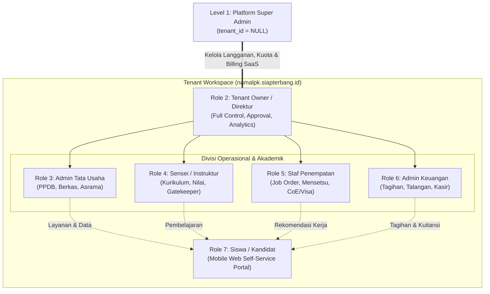
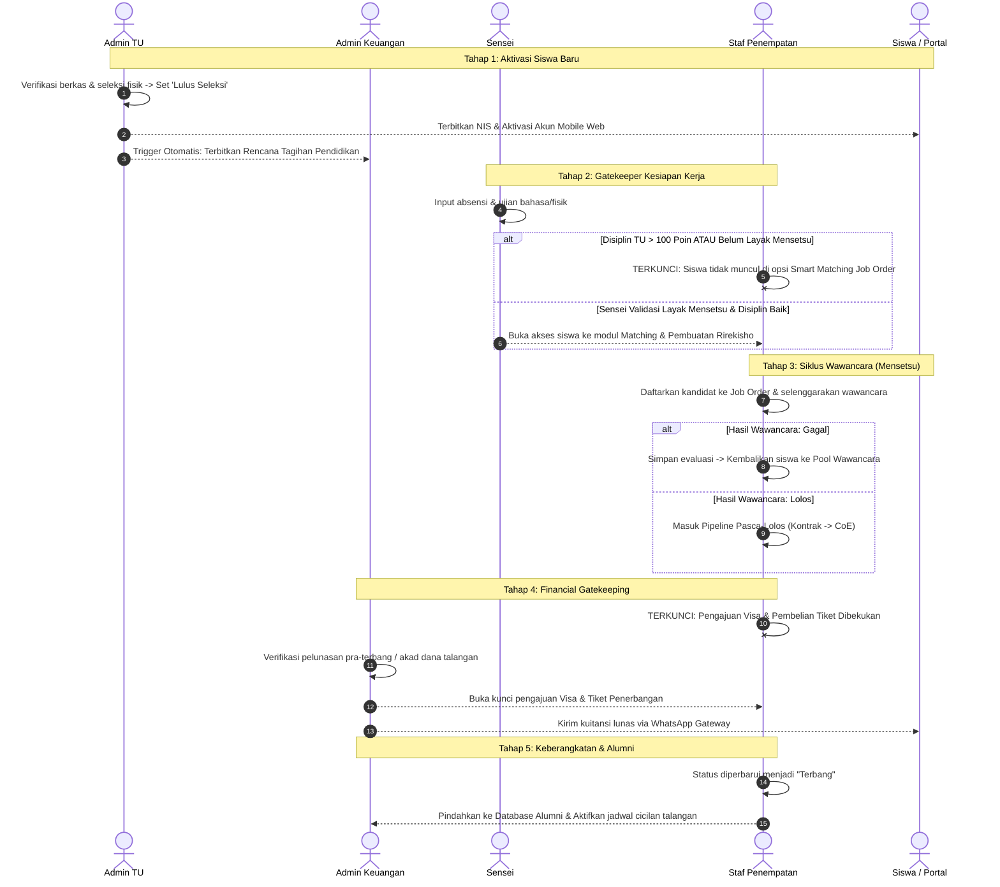

# SiapTerbang 🛫
> **Enterprise Multi-Tenant SaaS Platform for Overseas Manpower Training & Placement Agencies (LPK / Sending Organizations)**

[](LICENSE)
[](https://siapterbang.id)
[](https://siapterbang.id)
[](https://siapterbang.id)

---

## 📌 Executive Summary

**SiapTerbang** (`siapterbang.id`) adalah platform *B2B Multi-Tenant Software-as-a-Service (SaaS)* yang dirancang khusus untuk mengotomatisasi dan mengintegrasikan seluruh operasional **Lembaga Pelatihan Kerja (LPK)** dan **Penyalur Tenaga Kerja Luar Negeri / Sending Organization (SO)** di Indonesia.

Fokus program mencakup:
- 🇯🇵 **Jepang**: Magang (*Ginou Jisshusei*) & Pekerja Berketerampilan Spesifik (*Tokutei Ginou / SSW*)
- 🇰🇷 **Korea Selatan**: Program Pemerintah (*G-to-G*) & Swasta
- 🚢 **Global**: Perhotelan & Kapal Pesiar Internasional

SiapTerbang menyelesaikan masalah mendasar industri LPK yang selama ini terfragmentasi: dokumen fisik yang tercecer, tenggat masa berlaku paspor/MCU yang terlewat, kebocoran piutang & dana talangan, serta ketidaksinkronan antara kesiapan siswa dengan kebutuhan *Job Order*.

---

## ⚡ The Competitive Moat: 5 Celah Kritis yang Dipecahkan

Aplikasi administrasi sekolah atau ERP umum selalu gagal memenuhi kebutuhan LPK karena mengabaikan dinamika unik industri penempatan tenaga kerja migran. SiapTerbang menghadirkan 5 logika bisnis unik:

```
┌───────────────────────────────────────────────────────────────────────────┐
│                       5 CORE SYSTEM INNOVATIONS                           │
├───────────────────────────────────────────────────────────────────────────┤
│ 1. Asrama & Poin Disiplin    → Ambang batas pelanggaran kunci mensetsu    │
│ 2. Siklus Gagal & Rematching → Relasi Many-to-Many Siswa & Job Order      │
│ 3. Kalkulator Otomatis Refund→ Formula potong biaya terpakai transparan   │
│ 4. Auto-Rirekisho & Surat    → Template baku JIS Jepang & Kop Surat LPK   │
│ 5. WhatsApp Gateway Wali     → Notifikasi otomatis SPP, absensi & kelulusan│
└───────────────────────────────────────────────────────────────────────────┘
```

1. **Manajemen Asrama & Poin Pelanggaran Kedisiplinan**  
   LPK beroperasi dengan standar semi-militer. Sistem memantau kamar asrama dan mencatat poin pelanggaran harian. Jika poin siswa melebihi ambang batas (contoh: 100 poin), sistem **secara otomatis memblokir siswa dari seleksi wawancara (*mensetsu*)**.
2. **Siklus Gagal Wawancara & Rematching (*Many-to-Many*)**  
   Siswa yang belum lolos wawancara kerja tidak hangus. Sistem menyimpan catatan evaluasi (*feedback*) pewawancara dan otomatis mengembalikan siswa ke *talent pool* siap kerja untuk dicocokkan dengan *Job Order* berikutnya.
3. **Offboarding & Kalkulator Refund Terintegrasi**  
   Menghitung secara presisi sisa dana pengembalian bagi siswa yang mengundurkan diri (*cancel*):  
   $$\text{Sisa Refund} = \text{Total Setoran} - \sum (\text{Biaya MCU} + \text{Paspor} + \text{Seragam} + \text{Administrasi Terpakai})$$  
   Wajib melalui otorisasi *Tenant Owner* untuk mencegah kecurangan kasir/staf operasional.
4. **Auto-Generator Rirekisho (CV Standar Jepang) & Surat Dinas Resmi**  
   Menghilangkan pengetikan ulang berulang-ulang. Sekali klik menghasilkan file PDF Rirekisho berstandar JIS lengkap dengan pasfoto formal, serta surat pengantar paspor ke Imigrasi, surat rekomendasi Disnaker (ID CPMI), dan surat izin wali.
5. **WhatsApp Gateway Otomatis ke Orang Tua / Wali**  
   Mengirimkan pembaruan *real-time* ke ponsel orang tua: penerbitan tagihan SPP, kuitansi digital ber-QR Code saat pembayaran diverifikasi, peringatan otomatis jika siswa alpa $\ge 3$ hari berturut-turut, hingga pengumuman kelulusan kerja.

---

## 🏛️ Arsitektur Multi-Tenant & Hierarki 7 Role

SiapTerbang menggunakan model **Single Database Multi-Tenancy** dengan isolasi data tingkat tinggi (*Workspace Isolation*). Setiap tenant LPK memiliki partisi ruang kerja mandiri yang diidentifikasi oleh `tenant_id` unik dan subdomain eksklusif (contoh: `lpkmaju.siapterbang.id`).



### Matriks 7 Hak Akses Terintegrasi

| Level | Role | Sasaran Pengguna | Lingkup Akses & Kewenangan Kunci |
| :--- | :--- | :--- | :--- |
| **Level 1** | **1. Platform Super Admin** | Internal SiapTerbang | Ruang global (`tenant_id = NULL`). Monitoring MRR/ARR, manajemen kuota, aktivasi/suspend tenant, dan *Impersonate Mode*. |
| **Level 2** | **2. Tenant Owner / Direktur** | Direktur / Pemilik LPK | Dashboard eksekutif, RBAC staf, persetujuan pembatalan/refund/diskon, *audit trail*, dan billing langganan LPK. |
| **Level 2** | **3. Admin Tata Usaha (TU)** | Staf Kantor / TU | PPDB, nomor induk siswa (NIS), checklist berkas & *H-30 Expiry Tracker* paspor/MCU, asrama, generator surat dinas. |
| **Level 2** | **4. Sensei / Instruktur** | Guru Bahasa & Pelatih | Manajemen kurikulum (Minna no Nihongo), absensi harian (QR Code), penilaian berkala, & **Gatekeeper "Layak Mensetsu"**. |
| **Level 2** | **5. Staf Penempatan** | Divisi Job Matching / SO | Database mitra SO/Jepang, kriteria Job Order, auto-filter kandidat, jadwal wawancara, pipeline CoE/Visa, & database Alumni. |
| **Level 2** | **6. Admin Keuangan** | Bendahara / Kasir | Tagihan SPP & pemberangkatan, kuitansi digital WA ber-QR, manajemen dana talangan pasca-terbang, & **Financial Gatekeeping**. |
| **Level 2** | **7. Siswa / Kandidat** | Siswa Pelatihan | *Mobile Web Portal*: Visualisasi timeline tahapan (PPDB $\rightarrow$ Terbang), unggah berkas mandiri, cek nilai/presensi, info lowongan, & riwayat pembayaran. |

> [!NOTE]
> **Fleksibilitas Multi-Role per Akun**: Pada LPK daerah skala menengah-kecil, satu personel sering kali merangkap banyak peran (misal Admin TU merangkap Kasir). Sistem menggunakan **Permission-Based RBAC** sehingga satu akun dapat diberikan beberapa role sekaligus tanpa konflik hak akses.

---

## 🔒 Cross-Role Locks: Alur Otomasi & Titik Penguncian Antar-Divisi

Jantung kekuatan SiapTerbang terletak pada integritas alur kerja antar-divisi yang saling mengunci secara otomatis:



---

## 📦 Rincian Modul & Fungsionalitas Sistem

### 1. Modul Platform SaaS (Global Admin)
* **Revenue Analytics**: Real-time MRR, ARR, Churn Rate, LTV, dan pertumbuhan tenant aktif/trial/suspended.
* **Subscription & Limit Management**: Penguncian kapasitas kuota siswa aktif, alokasi media storage (GB), dan kuota pengiriman WhatsApp API.
* **Tenant Impersonation**: Memungkinkan Super Admin masuk ke dalam ruang kerja tenant untuk membantu diagnosis kendala operasional tanpa meminta kata sandi pengguna.
* **Global Template Repository**: Penyediaan template baku Rirekisho, kontrak magang, dan surat dinas yang siap diadaptasi oleh LPK baru.

### 2. Modul Akademik, Disiplin & Asrama (TU & Sensei)
* **PPDB Online & Input Tes Fisik**: Pencatatan tinggi/berat badan (BMI), tes buta warna, riwayat tato/tindik, dan tes matematika dasar.
* **Smart Expiry Tracker**: Indikator peringatan merah otomatis untuk berkas penting (Medical Check Up dan Paspor) pada $H-30$ sebelum masa berlaku habis.
* **Presensi QR Code & Auto-Alert**: Pemindaian kartu siswa secara instan. Logika peringatan terpicu otomatis saat siswa alpa 3 kali berurutan.
* **Poin Pelanggaran Asrama**: Sistem penilaian minus kedisiplinan yang terhubung langsung dengan kelayakan wawancara kerja.

### 3. Modul Penempatan, Job Matching & Alumni (Staf Penempatan)
* **Katalog Mitra Luar Negeri**: Manajemen data *Sending Organization (SO)* dan *Accepting Companies (User)* di Jepang, Korea, dsb.
* **Smart Matching Filter**: Filter otomatis kandidat berdasarkan: Kategori Kejuruan, Usia, Tinggi/Berat Badan, Kondisi Mata, dan Riwayat Nilai.
* **Rirekisho PDF Generator**: Penyusunan kurikulum vitae standar format Jepang secara instan dengan foto jas formal berlatar belakang standar.
* **Pipeline Stepper Pasca-Lolos**: Pemantauan progres tahap demi tahap: `Kontrak Kerja` $\rightarrow$ `Pengajuan CoE` $\rightarrow$ `CoE Terbit` $\rightarrow$ `Pengajuan Visa` $\rightarrow$ `Penerbitan Tiket & Terbang`.
* **Pelacakan Kontrak Alumni**: Pengingat otomatis saat kontrak 3 atau 5 tahun pekerja migran mendekati masa kadaluwarsa untuk opsi perpanjangan atau perpindahan status visa SSW.

### 4. Modul Keuangan & Dana Talangan (Admin Keuangan)
* **Multi-Scheme Billing**: Pengelolaan tagihan mandiri berkala vs skema dana talangan LPK/koperasi mitra.
* **Digital Receipt with QR Code**: Kuitansi digital terproteksi dengan verifikasi hash QR Code yang terkirim langsung ke kontak WhatsApp orang tua.
* **Kalkulator Refund Transparan**: Sistem kalkulasi pemotongan biaya bagi siswa mengundurkan diri untuk memitigasi sengketa finansial.
* **Pemisahan Buku Kas**: Pemisahan tegas antara saldo dana titipan pemberangkatan siswa dengan pos biaya operasional harian kantor/asrama.

### 5. Portal Mandiri Siswa (Mobile Web)
* **Visual Progress Tracker**: Representasi visual posisi tahapan siswa saat ini (`Pendaftaran` $\rightarrow$ `Pelatihan` $\rightarrow$ `Siap Wawancara` $\rightarrow$ `Proses Imigrasi` $\rightarrow$ `Terbang`).
* **Document Self-Upload**: Fitur pengambilan gambar langsung via kamera smartphone untuk dokumen pendukung dengan notifikasi alasan penolakan jika tidak valid.
* **Portal Lowongan Kerja & Feedback**: Informasi Job Order yang dibuka LPK beserta catatan evaluasi jika siswa belum berhasil lolos seleksi sebelumnya.

---

## 💎 Model Monetisasi SaaS (Tiered Pricing)

SiapTerbang menggunakan skema langganan berkala bertingkat (*Tiered Subscription*):

| Parameter | Paket Starter | Paket Pro *(Most Popular)* | Paket Enterprise |
| :--- | :--- | :--- | :--- |
| **Target LPK** | LPK Rintisan / Skala Kecil | LPK Berkembang / Pengirim Aktif | Asosiasi LPK / Sending Org Besar |
| **Estimasi Biaya** | **Rp 500.000 – Rp 750.000** / bln | **Rp 1.500.000 – Rp 2.500.000** / bln | **Rp 4.000.000+** / bln *(+ Setup Fee)* |
| **Batas Siswa Aktif** | Maksimal 100 Siswa | **Unlimited** | **Unlimited** |
| **Batas Akun Staf** | Maksimal 5 Staf | **Unlimited** | **Unlimited** |
| **Kapasitas Storage** | 5 GB | 50 GB | Dedicated / Custom |
| **Auto-Rirekisho** | ❌ Manual | ✅ Generator Otomatis | ✅ Generator Otomatis |
| **WhatsApp Gateway** | ❌ Tidak Termasuk | ✅ Notifikasi Otomatis Terintegrasi | ✅ Multi-Sender / Dedicated Nomor |
| **Dana Talangan** | ❌ Standar | ✅ Terintegrasi Penuh | ✅ Lanjutan + Multi-Koperasi |
| **Fitur Khusus** | Modul Dasar | Analisis Lengkap & Rematching | Multi-Cabang, Custom Domain, & Portal SO Luar Negeri |

---

## 🚀 Roadmap Pengembangan Produk

```
Fase 1: MVP (Bulan 1–2)
├── Arsitektur Multi-Tenant & Isolasi Workspace
├── Sistem RBAC 7 Role Terpadu
├── Modul PPDB, Manajemen Berkas & Expiry Tracker
├── Presensi QR Code & Modul Nilai Sensei
├── Tagihan Dasar & Pembayaran Manual
└── Portal Siswa (Mobile Responsive)
    Target: Validasi lapangan bersama 3–5 LPK Percontohan (Early Adopters)

Fase 2: Otomasi & Monetisasi (Bulan 3–4)
├── Mesin Auto-Generate Rirekisho & Surat Dinas (PDF)
├── Integrasi WhatsApp Notification Gateway (Fonnte/Wwebjs/Cloud API)
├── Siklus Otomatis Rematching Wawancara & Evaluasi
├── Modul Kalkulator Refund & Manajemen Dana Talangan
└── Billing SaaS Otomatis (Payment Gateway VA/QRIS)
    Target: Peluncuran komersial ke asosiasi LPK (Jawa Barat, Jawa Tengah, Jawa Timur)

Fase 3: Ekspansi Ekosistem (Bulan 5+)
├── Portal Akses Khusus Mitra Luar Negeri (SO / Perusahaan Jepang - Read Only)
├── Manajemen Portofolio Dana Talangan Lanjutan & Integrasi Lembaga Finansial
├── Pelaporan Terintegrasi Standar Disnaker & BP2MI (Siskotkln/Kemennaker)
└── Aplikasi Mobile Native (iOS & Android) untuk Siswa & Sensei
    Target: Skalabilitas ke ratusan tenant LPK di seluruh Indonesia
```

---

## 🛠️ Rekomendasi Tech Stack

* **Frontend**: Next.js 14+ (App Router), React, TypeScript, Tailwind CSS, shadcn/ui, Lucide Icons.
* **Backend**: Next.js Server Actions / API Routes atau NestJS (Node.js microservices).
* **Database**: PostgreSQL dengan Row-Level Security (RLS) & schema indexing berbasis `tenant_id`.
* **ORM**: Prisma ORM / Drizzle ORM.
* **File Storage**: S3-Compatible Cloud Storage (Cloudflare R2 / AWS S3) dengan akses *Presigned URL*.
* **PDF Engine**: `@react-pdf/renderer` atau Headless Chromium (Puppeteer) untuk presisi Rirekisho standar Jepang.
* **WhatsApp Gateway**: WhatsApp Business Cloud API / Modular Provider (Baileys / Fonnte).
* **Payment Gateway**: Midtrans / Xendit untuk tagihan otomatis SaaS dan SPP siswa.

---

## 📄 Lisensi & Hak Cipta

Dokumen spesifikasi, arsitektur, dan aset sistem ini berada di bawah hak kepemilikan **SiapTerbang Platform** (`siapterbang.id`). Seluruh hak cipta dilindungi undang-undang.

---

<p align="center">
  <b>SiapTerbang — Menjembatani Talenta Indonesia Menuju Panggung Dunia 🇮🇩 ✈️ 🇯🇵 🇰🇷</b>
</p>
